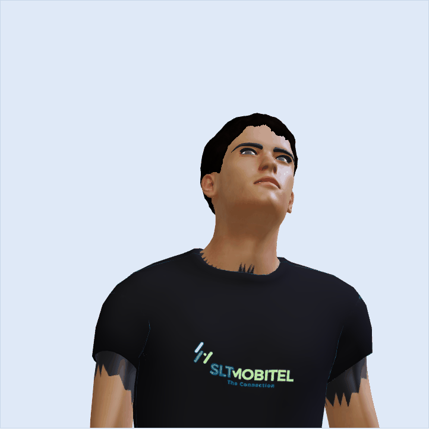
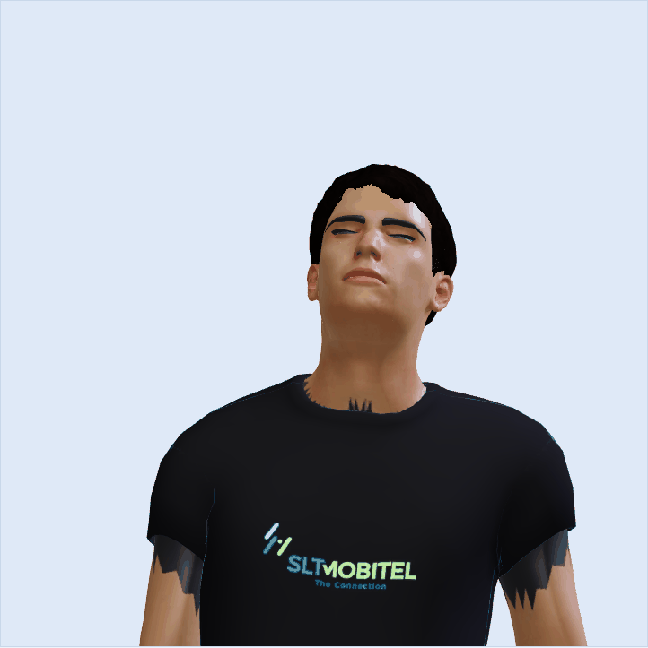
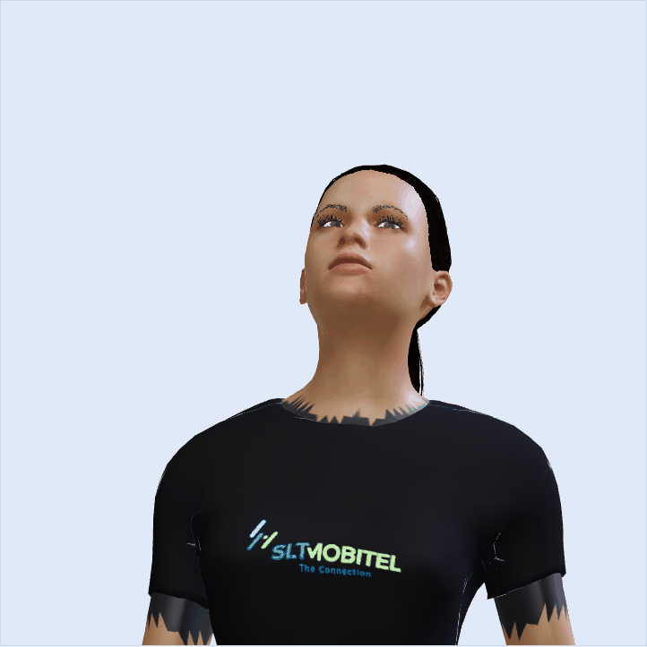
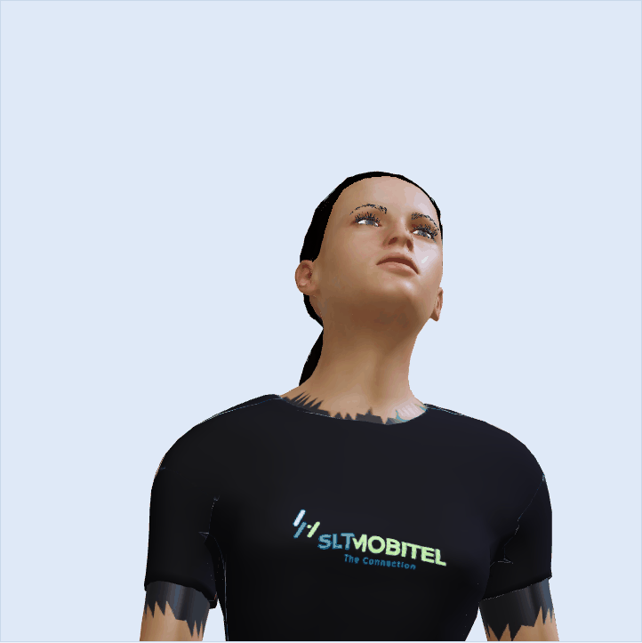

# Sri Lankan SLT avatar (R5)

> **Status after the lead's review of the real page screenshots (2026-10-16).** The South Asian set is an
> option, not the default: `AVATAR_VARIANT=south_asian` turns it on, `original` (default) keeps the first models.
> In `docs/avatar-shots/real_*.png` (headless Chrome with software rendering, not a real GPU) the faces are visible
> but look flat and posterized, the female has grey green patches on the face, and one desktop shot of the male shows
> only the shirt because the skin mesh had not been drawn yet. How much of that is the software renderer and how much
> is the models was not separated, because no real GPU was available. Look at it in your own browser before making it
> the default, and tell me what you see. The agent's own text below says the real page looks good; the screenshots
> do not fully support that.


Two new avatar files keep the rig, blend shapes and viseme morph targets of the CC0 sources. Only textures and a few
material factors change.

| File | Source | Size | Compression |
|-|-|-|-|
| `frontend/avatar/assets/male_sl.glb` | `male.glb` (19.3 MB) | 3.65 MB | WebP textures |
| `frontend/avatar/assets/female_sl.glb` | `mpfb.glb` (36.8 MB) | 7.37 MB | WebP textures and Meshopt mesh compression |

The originals are untouched and remain the legacy fallback. Draco is off.

## Rebuild

Blender 5.2, headless, from the repo root (cmd syntax):

```
set B="C:\Program Files\Blender Foundation\Blender 5.2\blender.exe"
%B% --background --python tools/avatar/build_avatar.py -- --src frontend/avatar/assets/male.glb --out frontend/avatar/assets/male_sl.glb
%B% --background --python tools/avatar/build_avatar.py -- --src frontend/avatar/assets/mpfb.glb --out frontend/avatar/assets/female_sl.glb --meshopt 1
```

About 10 seconds each. `--skin medium_brown|light_brown|deep_brown|#RRGGBB` picks the tone (default from
`config/avatar.yaml`), `--config` points at another YAML file, `--meshopt 1` turns on Meshopt (the female file is 9.1 MB
without it).

Validate and smoke test (repo venv, system Chrome):

```
venv\Scripts\python.exe tools/avatar/validate_output.py frontend/avatar/assets/male.glb frontend/avatar/assets/male_sl.glb
venv\Scripts\python.exe tools/avatar/validate_output.py frontend/avatar/assets/mpfb.glb frontend/avatar/assets/female_sl.glb
venv\Scripts\python.exe tools/avatar/smoke_test.py
```

`tools/avatar/inspect_glb.py` lists meshes, materials and textures of any GLB inside Blender.

## Skin presets (`config/avatar.yaml`)

| Preset | On screen colour (sRGB) | Description |
|-|-|-|
| `light_brown` | 201, 150, 112 | lighter Sri Lankan complexion |
| `medium_brown` (default) | 166, 112, 78 | medium brown |
| `deep_brown` | 112, 72, 50 | darker complexion |

The values are the intended look on screen under the app's lighting. The texture is darker, because TalkingHead lights
the avatar at ambient 2, direct 30 with ACES tone mapping: a texture at the plain preset colour rendered as pale peach in
the first test. `skin_light_compensation: 0.3` (linear factor on the albedo) was set by measuring renders: arms and neck
came out near 150, 121, 88 for the medium preset against a target of 166, 112, 78, and the face renders lighter because
it gets more light. Rebuild after changing the factor or the app lighting. All three presets and a hex value built
without errors, but only `medium_brown` was rendered and looked at.

## What changes per material

| Material | Change |
|-|-|
| `Human.body` (head, torso, arms, hands) | Base colour texture, 2048 px, recolored. Linear light tone map: each texel keeps its luminance relative to the mean of the skin area (the skin area is found by rasterising the body mesh UVs, so the flat background does not count), the mean colour moves to the preset, and 25 percent of the texel's own chroma offset stays so lips and blush survive without the pink cast of the source. The head island (mesh above 1.52 m) is scaled by 0.95 (0.8 made it too dark in the real page) because the face is lit harder than the torso on screen, and the skin specular level is 0.25 so it does not turn pale. The head is part of this same material and texture (no separate face texture exists). This is not a flat tint. |
| `Human.short02` (male hair), `Human.ponytail01` (female hair) | Luminance preserving recolor to near black brown (30, 22, 18 times the compensation), highlight range compressed, alpha kept; semi transparent edge texels are flattened and darkened to remove the light halo. Roughness 1 and specular 0 so the cool key light gives no blue sheen. |
| `Human.eyebrow001`, `Human.eyelashes01`, `Human.mindfront_eyebrows_02`, `Human.mindfront_eyelashes_02` | Base colour factor (they have no texture) set to near black brown. |
| `Human.low-poly`, `Human.high-poly` (eyes) | Pixels with HSV saturation above about 0.35 (the iris, soft edged) recolored dark brown, keeping their detail. Sclera and pupil are kept. |
| `Human.male_casualsuit04`, `Human.female_casualsuit01` | The four shirt UV islands (front, back, two sleeves, found as connected mesh components above 1.10 m) filled with near black (22, 22, 24), specular 0, roughness 1. The trousers island keeps its jeans texture. The base colour is 4096 px (sources were 1024 and 2048), shirt only. The logo is baked into the front panel, see below. |
| `Human.teeth_base`, `Human.tongue01` | Untouched, textures downscaled to 1024. |

Armature, vertex groups, shape keys and geometry are not touched.

## The logo

`frontend/assets/mobitel-logo.png` (3840 x 1451, RGBA, transparent background) is used unmodified: no recolor, no crop,
one uniform scale, aspect ratio 2.65 kept. It is 0.18 m wide and 0.068 m high on the chest, centred on the body centre
line (x = 0), with its centre at 73.5 percent of body height (male) or 72.5 percent (female). Both are set under `logo:`
in the YAML.

Method chosen: bake into the shirt base colour texture, not a separate decal patch. Reason: the shirt is skinned to the
same armature, so a texture follows every bone with no extra geometry, no copied weights, no z fighting and no second
draw call. For every triangle of the front panel the script takes its texels, projects them straight from the front (x and
z of the 3D position) into logo space and samples the logo with 4 x 4 supersampling in linear light, composited over the
fabric colour. The shirt texture is 4096 px, so the logo is about 500 texels wide.

## Validation (run on 2026-10-15)

`validate_output.py` result: PASS for both.

| Check | Male | Female |
|-|-|-|
| Morph target names and order, all 8 meshes | identical (211 targets) | identical (155 targets) |
| ARKit and Oculus names lost from the source | none | none |
| Joints | 76, none added or lost | 67, none added or lost |
| Node names, material names, alphaMode, doubleSided | identical | identical |
| Images without data | 0 of 7 | 0 of 7 |
| Size | 3.65 MB | 7.37 MB |

`viseme_sil` is absent from the female source too, so it is absent here. Image sizes inside the files: body 140 to
170 KB, shirt 124 and 232 KB, hair 51 and 149 KB.

Smoke test (`tools/avatar/smoke_test.py`): headless Chrome with SwiftShader, `demo.html`, `assets/sample.wav` played with
the "Sample speech" button. `avatar.js` must not change, so the avatar file is swapped with a Playwright route
(`mpfb.glb` answered with `female_sl.glb`, `male.glb` with `male_sl.glb`). Both new files load, TalkingHead sees 81 (male)
and 80 (female) morph targets, and during the sample the applied `jawOpen` peaks at about 0.40 and the viseme targets at
0.65, with 8 or 9 different visemes seen, the same as with the original files. Numbers are in
`docs/avatar-shots/smoke_result.json`. For the male file the console shows `Dynamic bones setup failed: Third parameter
must be an array of bone configs`, before and after; it comes from the existing `avatar.js` (no bones configured for the
male avatar), not from this build.

## Before and after

Camera: `cameraView: "upper"`, `cameraDistance: -0.3`, 720 px stage, taken before the sample plays.

| Before | After |
|-|-|
|  |  |
|  |  |

## Real voice screen check (2026-10-16)

The real page (not demo.html) was checked with `tools/avatar/real_page_shot.py` against the test server on port 8051, at
390 x 844 and 1280 x 800, both genders, 20 s after load. Images: `docs/avatar-shots/real_male_mobile.png`,
`real_male_desktop.png`, `real_female_mobile.png`, `real_female_desktop.png`.

What was found:

* The "face hidden behind black hair" frames are not caused by the hair or the textures. For the first 10 to 17 s after the
  avatar appears, software WebGL (SwiftShader, the headless test browser) draws the shirt, hair and teeth but NOT the
  body skin mesh (head, neck, arms), so only a black hair shape and the teeth show. The original `male.glb` and `mpfb.glb`
  do exactly the same in the same script (checked, variant=original: blue shirt, brown hair and teeth, no skin for the first
  frames). A screenshot taken in that window shows the symptom for either variant; on a real GPU it was not seen here and
  was not tested. Wait for the skin before judging (the script waits 20 s; set SHOT_WAIT in milliseconds to change it).
* The jagged light skin patches at the collar, shoulders and armpits are also in the original (they show as light patches
  on the blue shirt): the shirt is built from four separate panels and the body shows through the gaps. `frustumCulled` is
  already false and a polygon offset on the shirt did not change it, so it is geometry, not z fighting.
  Fix in this build: body triangles that lie behind the shirt, or sit on the shoulder line within 4 cm of it, are painted shirt
  colour in the skin texture (588 triangles female, 696 male, `under_shirt_tris` in `build_avatar.py`). Result: the orange
  and beige patches are gone, small grey brown patches remain at the collar corners and armpits of the female because
  bare skin material is glossier than the fabric. The male shows only tiny gaps at the sleeve hems.
* Skin tone in the real page: the first fix rendered a little dark there (face about 130, 92, 72); with the head scale at
  0.95 it reads as medium brown. Eyes, brows and mouth are visible on both avatars; hair is black and sits on the head.
* Lip sync in the real page: sample.wav through `window.avatarRenderer.attachAudioStream` moved jawOpen to 0.39 to 0.40 and
  visemes to 0.65 to 0.73 for both genders.
* The female avatar looks darker brown than the male under the same light, because the source female texture is darker
  around the face. Not retuned per gender.

## Limits and honest notes

* Neckline: the male T-shirt has a round crew neck. The female one is a crew neck cut wider and lower. Geometry was not
  changed.
* The shirt is plain black. The painted trims and the old logo of the source shirts were covered. No fabric detail
  beyond the source mesh folds and normal map.
* Logo colours: the texture holds the exact logo colours, but under the app's bright light and ACES tone mapping the
  dark blue "SLT" renders as a light teal and the green looks pale. Dark blue also has little contrast on black fabric.
  Lower app lights or a light patch behind the logo would fix it; both are decisions for the lead, and the logo was not
  altered.
* Logo sharpness: the shirt texture is now 4096 px (it was 2048). In the new screenshots the lettering and the three
  strokes are crisp at the close up distance; the small "The Connection" line is readable but thin. Shirt WebP grew by
  about 0.2 MB.
* Skin tone match (second pass, after the coordinator saw a pale pink face): the first build used one mean for head and
  body and a 0.5 chroma share, and the pink source face plus the default specular made the face render pale. Now: chroma
  share 0.25, head albedo x0.8, skin specular 0.25. In the new screenshots, looked at with Read, face, ears, neck and arms
  are the same medium brown on the male. On the female the face is still a touch lighter and more reddish than the arms
  and the area right around the eyes is still slightly warm, but it no longer reads pink or grey; lips are a darker,
  slightly redder brown. Sampled pixels (rough, 3 x 3 means): male neck 134, 93, 65 and arm 144, 100, 68; female neck
  175, 138, 107 and arm 182, 148, 121. Tried and dropped: separate head and body means left a visible neck seam.
* Hair: black. The light halo at the male hairline is gone in the screenshot; a thin dark outline shows around the female
  hair, which is the flattened edge texels.
* Jeans stay blue (not part of the request). The male jeans texture is a 1024 px source lifted to 2048 by bilinear
  resampling, so it is no sharper than before.
* The female file needs Meshopt to get under 8 MB (9.1 MB without). Textures total about 1 MB; the rest is morph target
  data of the eyebrow and eyelash meshes (23 and 33 targets on 12k and 17k vertices), which cannot shrink without touching
  the shape keys.
* Only the medium_brown build was viewed. Light and deep builds were generated without errors but not rendered.
* The runtime three.js tint in `docs/patches/E_avatar_renderer.md` is untested.

## Licences

Source GLBs: `male.glb` is built from CC0 MakeHuman and MPFB assets, `mpfb.glb` is CC0 (see `docs/THIRD_PARTY.md`). The
recolored textures are derivative CC0 work. The logo is the SLT file already in the repo, used as the company's own mark.
Blender and its glTF exporter are GPL tools only; their output carries no licence claim. Rows for `docs/THIRD_PARTY.md` are
in `docs/patches/E_third_party.md`, the Git LFS line in `docs/patches/E_gitattributes.txt`, the loader and renderer hunks
in `docs/patches/E_avatar_renderer.md`.
